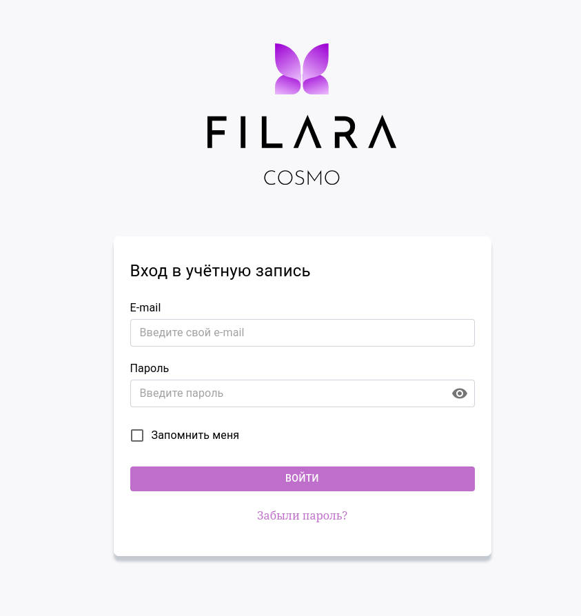
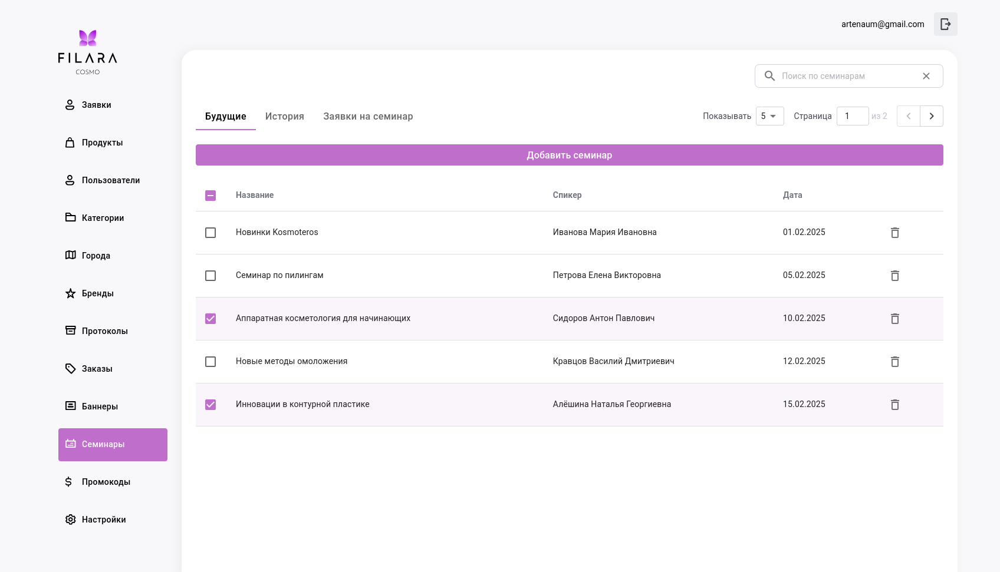
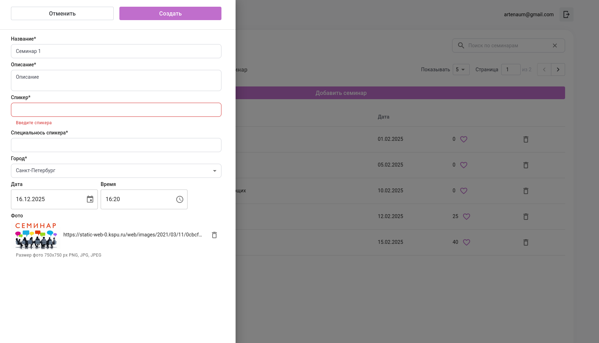
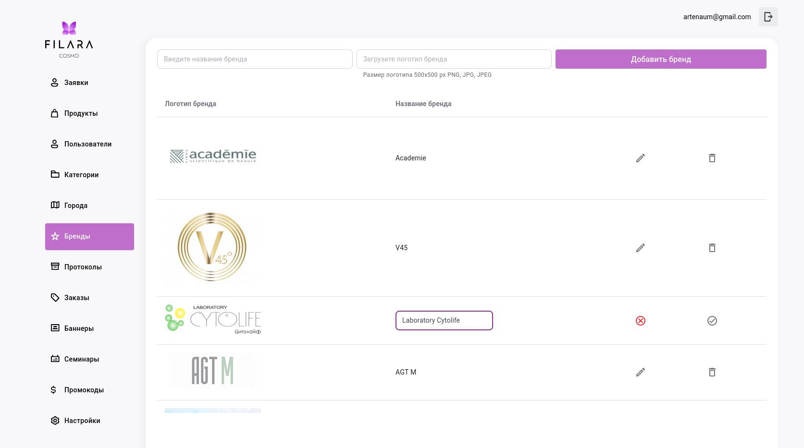

## FILARA
Панель администрирования веб-ресурса на React и TypeScript.

Цель данного проекта - закрепление ранее полученых навыков использования React и TypeScript, а также освоение архитектуры FSD.
Помимо React и TypeScript, на проекте используются Redux и Mobx для управления состоянием, RTKQuery для API запросов, React Router для навигации, React Hook Form валидации форм и Material UI для интерфейса.
В качестве сборщика используется Vite, а для линтинга ESLint и Prettier.

Реализованы следующие страницы: Страница аутентификации, страница семинаров и страница брендов.

Ссылка на демо:   

### Страница аутентификации

На странице представлена форма для входа в учётную запись. Пользователи и пароли хранятся в обычном JSON файле.
Остальные страницы недоступны пока не будет выполнен вход. Состояние сессии хранится в виде JWT токена в localStorage.   

### Страница семинаров

На странице представлены таблицы с будущеми, прошедшими семинарами, а также таблица с заявками на семинары.
Для таблиц используется модифицированный MUI компонент Table, который соединён с поисковой строкой и отдельным компонентом пагинации. Для того, чтобы местоположение компонентов пагинации и поиска не зависило от табличного, используется компонент Portal. Модифицированный табличный компонент также позволяет встраивать кнопки и текстовые поля.
Строка поиска использует debounce для оптимизации.   

### Форма добавления семинара

Форма для добавления семинара содержит текстовые поля с валидацией, dropdown меню, компоненты DatePicker и TimePicker из Material UI и возможность вставить ссылку на превью картинку. Ссылка валидируется по Regex.   

### Страница брендов

В отличие от остальных страниц, страница брендов использует MobX для управления состоянием. Здесь возможность внедрения в таблицу кнопок и текстовых полей используется в большей мере. Через саму таблицу можно редактировать название брендов и удалять их.
