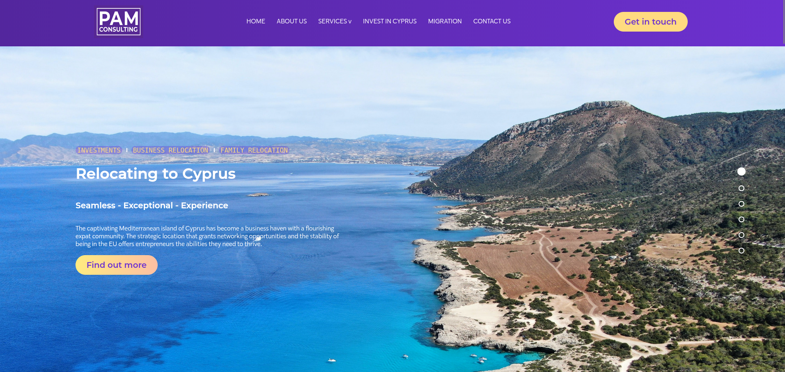
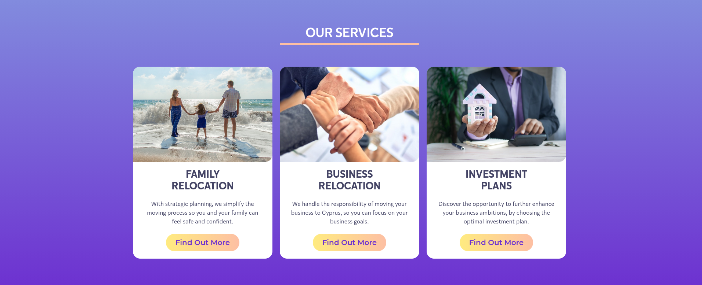
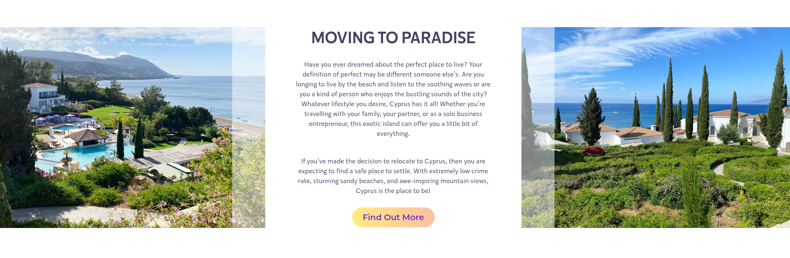
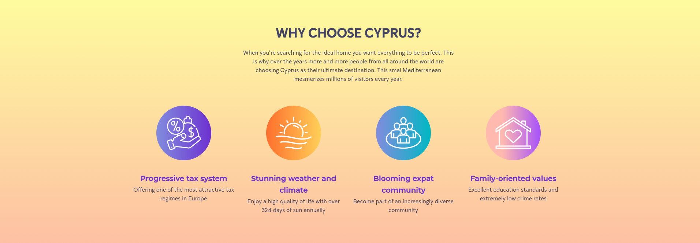
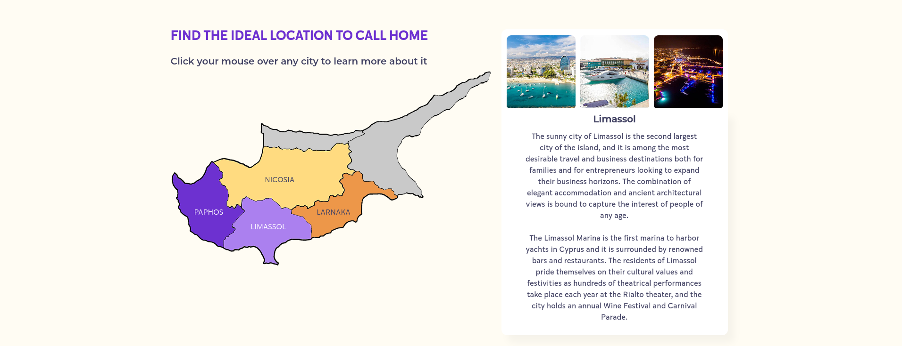
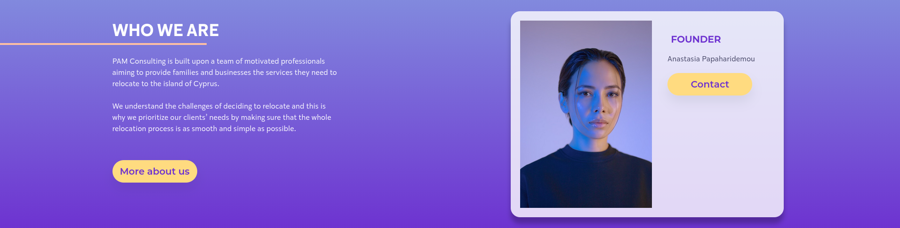
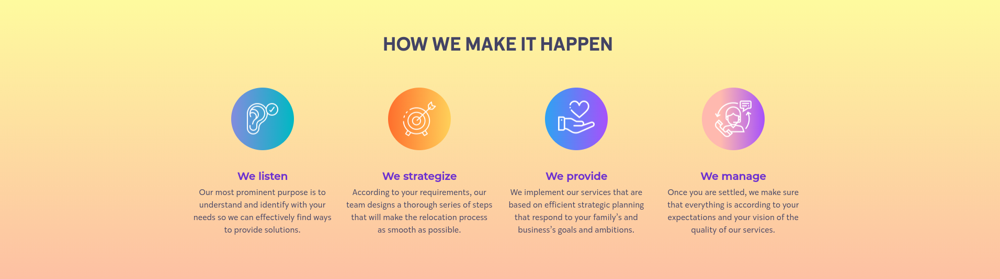
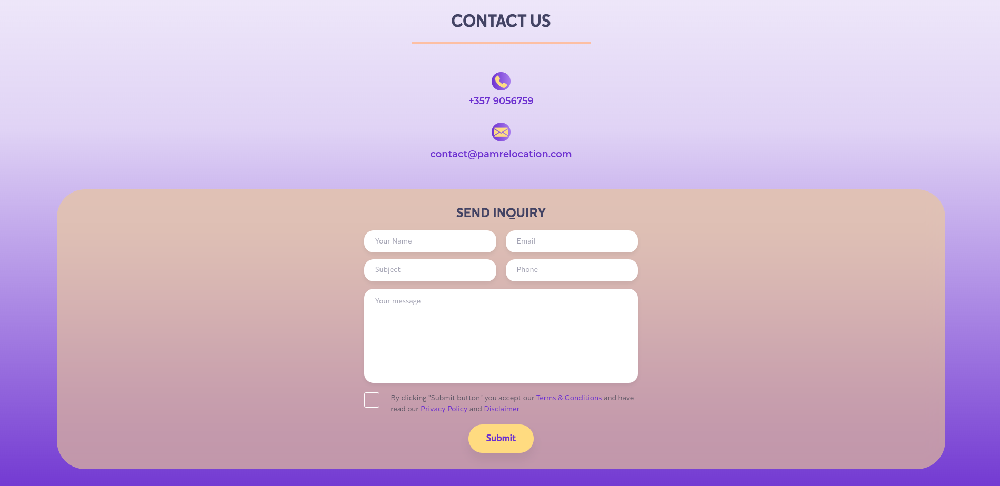
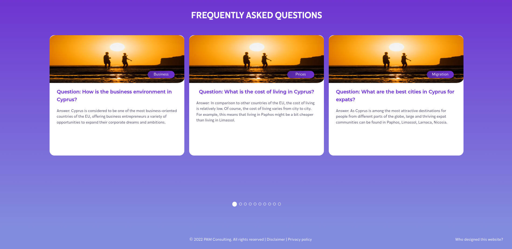

## PAMConsulting

Главная страница туристического сайта.

Цель данного проекта - совершенствование навыков адаптивной pixel perfect вёрстки по макетам из Figma.
На проекте используются обычные HTML и CSS. Адаптивность осуществляется за счёт использования media query и JavaScript.
Для слайдера с изображениями и слайдера в секции FAQ используется библиотека Swiper с кастомными настройками.
У карты Кипра реализован клик только по городам Лимассол и Никосии.

[Ссылка на демо](https://pamconsulting-tau.vercel.app/)   

