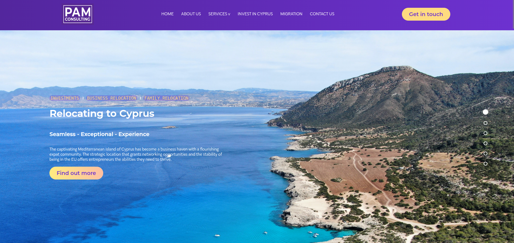
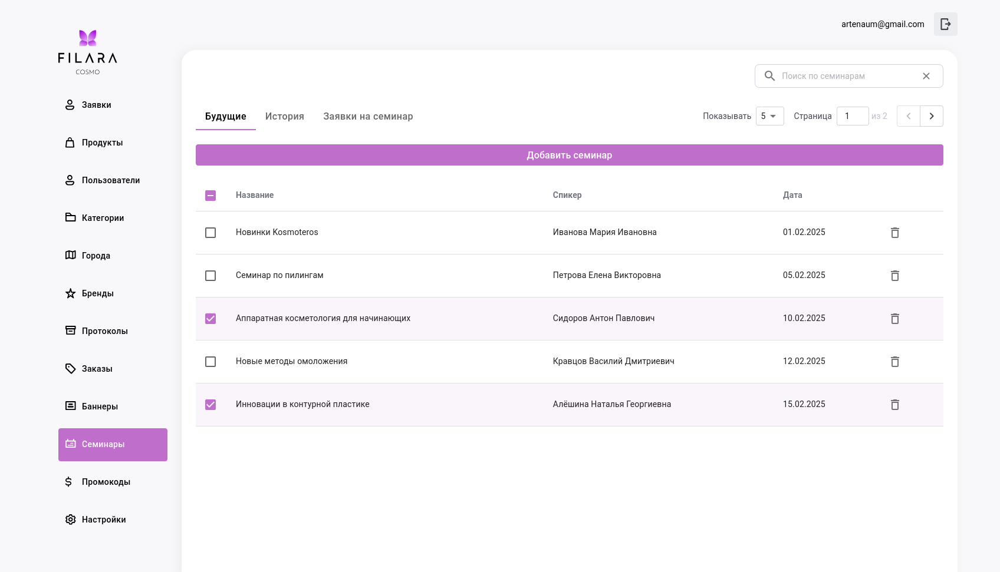
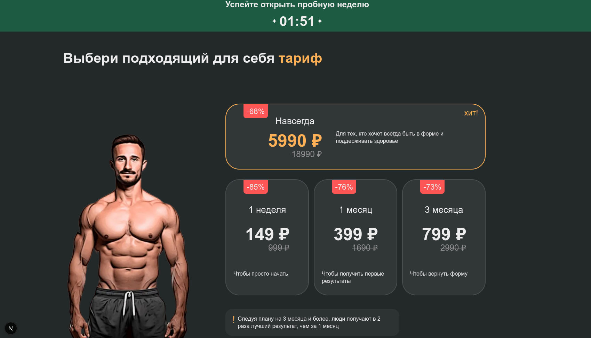

Здесь представлено три самых значимых проекта, над которыми я работал в ходе стажировки.   

## Проект 1: PAMConsulting
Главная страница туристического сайта.

[Ссылка на подробное описание и код](https://github.com/Artenaum/FrontendPortfolio/tree/main/PAMConsulting#readme)  
Ссылка на демо:   

## Проект 2: FILARA
Панель администрирования веб-ресурса на React и TypeScript.

[Ссылка на подробное описание и код](https://github.com/Artenaum/FrontendPortfolio/tree/main/Filara#readme)  
Ссылка на демо:

Данные для входа  
Email: ivan@spaceacademy.org  
Пароль: qwerty123   

## Проект 3: Fithub
Страница сайта по фитнесу на Next.js.

[Ссылка на подробное описание и код](https://github.com/Artenaum/FrontendPortfolio/tree/main/Fithub#readme)  
Ссылка на демо:   
