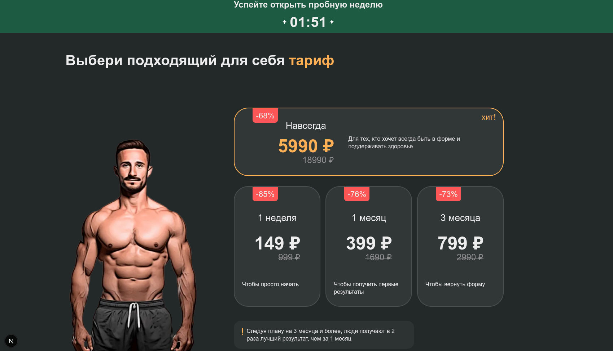

## Fithub
Страница сайта по фитнесу на Next.js.

Цель данного проекта - ознакомление с Next.js.
Сам проект - это страница с тарифами со скидкой, а также таймером сверху, по истечению которого скидки исчезают. У таймера реализована простая анимация мигания через keyframes.
Вместо Material UI используются собственные компоненты, стилизованные с TailwindCSS.

Ссылка на демо:   

